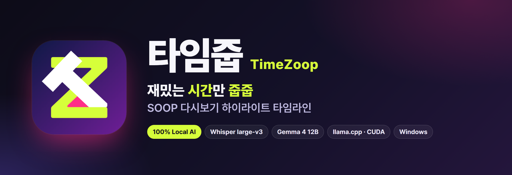
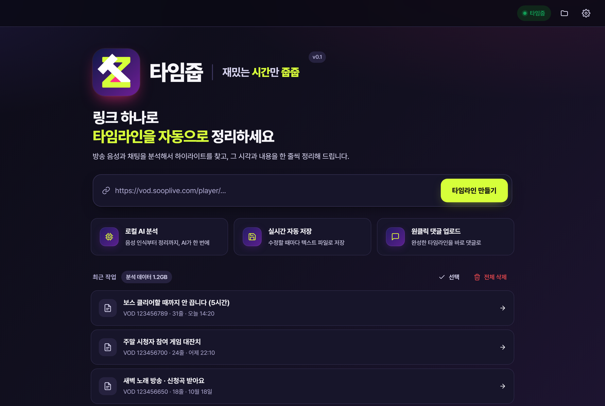
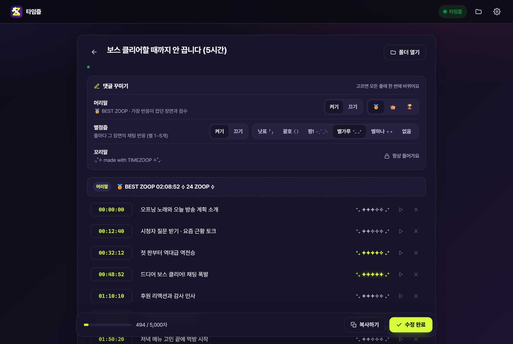
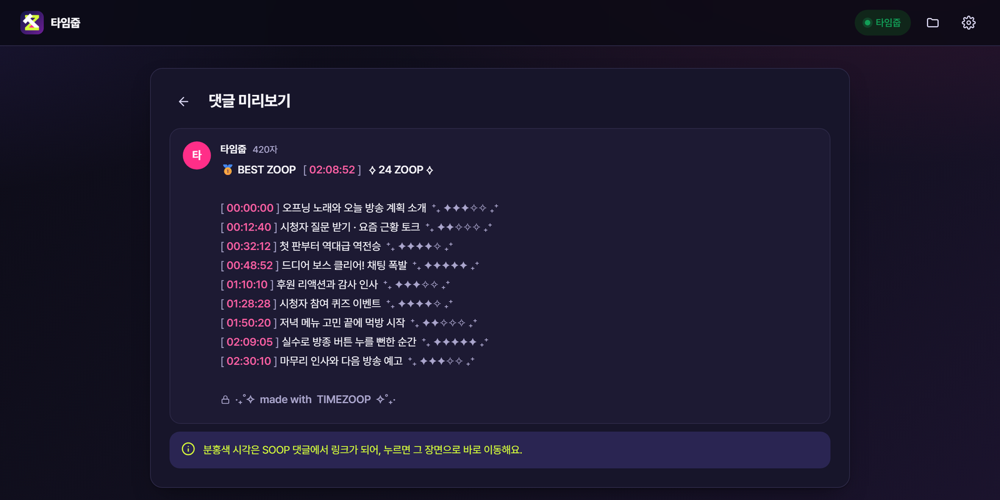
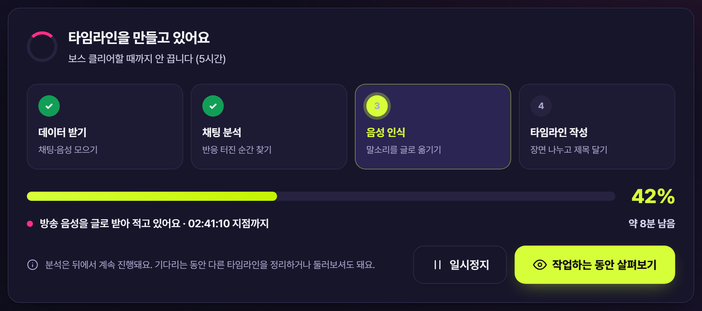
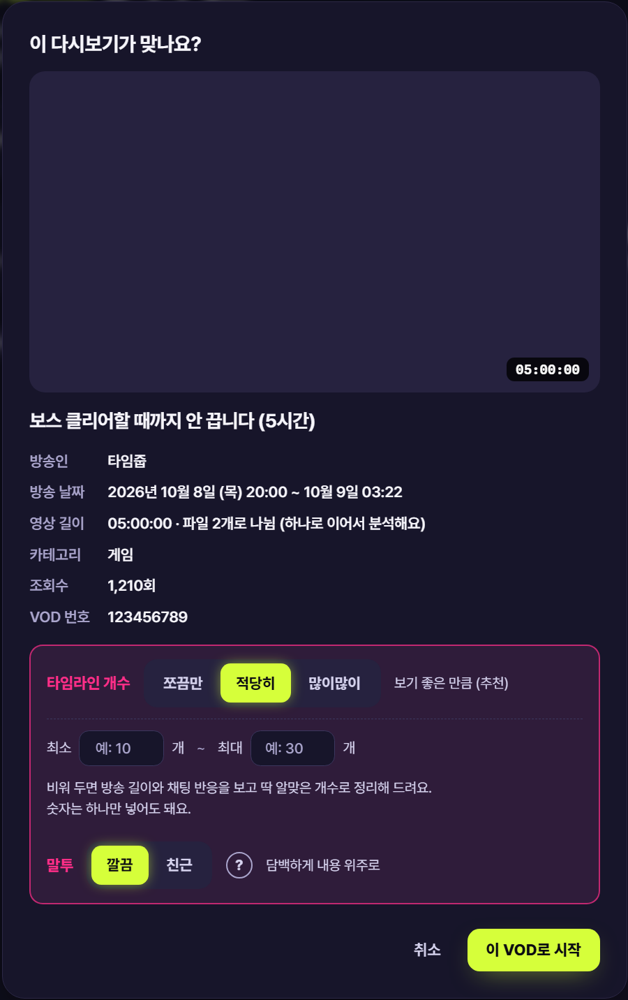
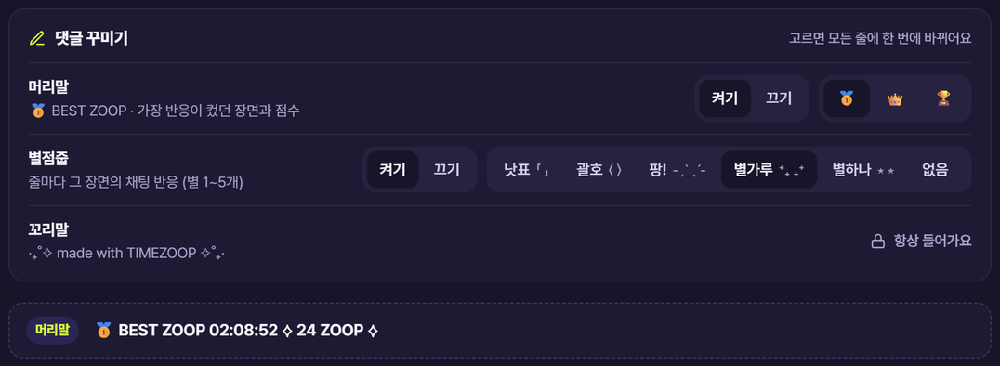
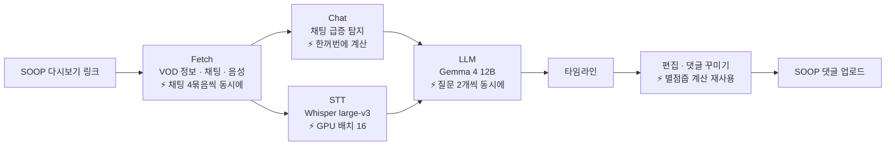

<p align="center">
  
</p>

<p align="center">
  <a href="../../releases/latest"></a>
  
  
  
  
  <a href="LICENSE"></a>
  <a href="https://discord.gg/jgCfUUYncp"></a>
</p>

<p align="center">
  <b>SOOP 다시보기 링크 하나로 하이라이트 타임라인을 만들고, 댓글로 올려 주는 Windows 앱</b><br>
  채팅과 방송 음성을 <b>내 PC 안의 AI</b>로 분석합니다. 외부 AI 서비스로는 아무것도 보내지 않습니다.
</p>

<p align="center">
  <a href="../../releases/latest"><b>⬇ 다운로드</b></a> ·
  <a href="사용설명서.md">사용설명서</a> ·
  <a href="패치노트.md">패치노트</a> ·
  <a href="https://discord.gg/jgCfUUYncp">디스코드 (피드백 · 버그 제보)</a>
</p>

<br>

<p align="center"></p>

## 목차

- [이런 걸 만들어 줘요](#이런-걸-만들어-줘요)
- [주요 기능](#주요-기능)
- [화면](#화면)
- [타임라인 개수 고르기](#타임라인-개수-고르기)
- [댓글 꾸미기](#댓글-꾸미기)
- [설치](#설치)
- [어떻게 동작하나요](#어떻게-동작하나요)
- [Tech Stack](#tech-stack)
- [Models](#models)
- [개발](#개발)
- [개인정보](#개인정보)
- [피드백](#피드백)
- [License](#license)

## 이런 걸 만들어 줘요

```
🥇 BEST ZOOP [ 00:48:52 ] ⟡ 24 ZOOP ⟡

[ 00:00:00 ] 오프닝 노래와 오늘 방송 계획 소개　   ⁺₊ ✦✦✦✧✧ ₊⁺
[ 00:12:40 ] 시청자 질문 받기 · 요즘 근황 토크　　 ⁺₊ ✦✦✧✧✧ ₊⁺
[ 00:48:52 ] 드디어 보스 클리어! 채팅 폭발　　　   ⁺₊ ✦✦✦✦✦ ₊⁺
[ 01:10:10 ] 후원 리액션과 감사 인사　　　　　　   ⁺₊ ✦✦✦✧✧ ₊⁺

‧₊˚✧  made with  TIMEZOOP  ✧˚₊‧
```

SOOP 댓글에 올라간 모습이에요. 시각은 SOOP이 `[ ]`로 감싼 링크로 바꿔 주고, 누르면 그 장면으로 바로 이동합니다.

- **BEST ZOOP** — 채팅 반응이 가장 컸던 장면과 그 장면의 분당 반응 점수
- **별점줍** — 줄마다 그 장면의 반응을 별 1~5개로 (같은 방송 안 순위). SOOP 댓글에서 같은 세로줄에 맞춰 보이도록 공백을 자동으로 채워요

## 주요 기능

| | 기능 | 설명 |
|:-:|---|---|
| 🎯 | **자동 하이라이트** | 채팅이 몰린 순간 + 방송 음성으로 주제가 바뀐 지점을 찾아 장면마다 제목을 붙여요. 타임라인 개수는 **쪼끔만 / 적당히 / 많이많이**, 제목 말투는 **깔끔 / 친근** 중에서 골라요 |
| ✏️ | **편집 + 자동 저장** | 제목·시각 수정, 줄 추가·삭제, ▶로 그 장면 열기. 고칠 때마다 `문서\타임줍\업로드날짜_스트리머_제목 [VOD번호].txt`로 저장 |
| 💬 | **원클릭 업로드** | SOOP 공식 로그인 창으로 로그인 → 댓글로 바로. 5,000자를 넘으면 나눠서 올려요. 다 올리면 **[가서 확인하기]**로 그 다시보기를 바로 열어요 |
| 🔞 | **연령·구독 제한 다시보기** | 그 다시보기를 볼 수 있는 SOOP 계정으로 로그인하면 똑같이 분석할 수 있어요. 볼 수 없는 계정이면 이유(성인 인증 필요, 구독자 전용 등)를 알려 드려요 |
| ⏸️ | **작업 관리** | 진행률·남은 시간(이 PC 속도를 학습), 일시정지/다시 시작, 낮은 우선순위로 실행. 작업 속도는 높은 속도 / 낮은 속도 중에서 골라요 |
| 🌙 | **다크 / 라이트** | 시스템 설정을 따르거나 직접 고르기 |
| 🎨 | **댓글 꾸미기** | 머리말 메달(🥇 👑 🏆), 별점줍 모양 6가지, 켜기/끄기 — 모든 줄에 한 번에 |

## 화면

<table>
  <tr>
    <td width="50%"><p align="center"><sub>편집 · 댓글 꾸미기</sub></p></td>
    <td width="50%"><p align="center"><sub>댓글 미리보기</sub></p></td>
  </tr>
  <tr>
    <td colspan="2"><p align="center"><sub>분석 진행 · 일시정지 · 작업하는 동안 살펴보기</sub></p></td>
  </tr>
</table>

## 타임라인 개수 · 말투 고르기

분석을 시작하기 전 다시보기 확인 창에서 타임라인을 얼마나 뽑을지, 제목을 어떤 말투로 쓸지 고를 수 있어요. 고른 값은 다음 분석에도 그대로 쓰여요.

<p align="center"></p>

| 선택 | 이런 분께 | 예 (4시간 50분 방송) |
|---|---|---|
| 쪼끔만 | 굵직한 장면만 | 약 15줄 |
| 적당히 (기본) | 보기 좋은 만큼 | 약 30줄 |
| 많이많이 | 주제가 바뀐 곳을 촘촘하게 | 약 45줄 |

- **최소 ○개 ~ 최대 ○개**를 넣으면 그 범위로 맞춰요. 최대보다 많으면 채팅 반응이 약한 줄부터 빼고(첫 줄은 남김), 최소보다 적으면 채팅이 몰린 순간을 더 찾아 채워요.
- 비워 두면 방송 길이와 채팅 반응을 보고 알맞은 개수로 정리해요. 개수 상한은 없어서 소통이 몰린 방송일수록 더 많이 나와요.

**말투**는 깔끔 / 친근 중에서 골라요. 옆의 **(?)**를 누르면 두 말투로 올린 댓글 예시가 나와요.

| 깔끔 (기본) | 친근 |
|---|---|
| 방송 시작 인사 및 의상·효과 오류 점검 | 방송 ON, 시작부터 의상 효과 고장남ㅋㅋ |
| 취기 어린 헛소리와 뜬금없는 고양이 언급 | 술기운에 아무말 대잔치 (갑분 고양이) |
| 족발 쌈 먹방과 나무젓가락 습관 잡담 | 족발 쌈 먹방 + 나무젓가락 TMI |
| 냄새를 따라갔다가 스토커와 마주친 괴담 | [괴담] 냄새 따라갔다가 스토커 마주침 |

## 댓글 꾸미기

편집 화면의 **댓글 꾸미기**에서 고르면 모든 줄에 한 번에 바뀌고, 첫 줄 위 머리말 칸에서 바로 확인할 수 있어요. 고른 설정은 다음 타임라인에도 그대로 쓰여요.

<p align="center"></p>

| 항목 | 고를 수 있는 것 |
|---|---|
| **머리말** (BEST ZOOP) | 켜기 / 끄기 · 메달 🥇 👑 🏆 |
| **별점줍** (줄마다 반응 별점) | 켜기 / 끄기 · 모양 6가지 (아래) · SOOP 댓글에서 같은 세로줄로 자동 맞춤 |
| **꼬리말** | `‧₊˚✧  made with  TIMEZOOP  ✧˚₊‧` · 항상 들어가요 |

| 별점줍 모양 | 댓글에 들어가는 모습 |
|---|---|
| 별가루 (기본) | `[ 00:48:52 ] 드디어 보스 클리어!  ⁺₊ ✦✦✦✦✧ ₊⁺` |
| 낫표 | `[ 00:48:52 ] 드디어 보스 클리어!  「 ✦✦✦✦✧ 」` |
| 괄호 | `[ 00:48:52 ] 드디어 보스 클리어!  〈 ✦✦✦✦✧ 〉` |
| 팡! | `[ 00:48:52 ] 드디어 보스 클리어!  -ˏˋ ✦✦✦✦✧ ˎˊ-` |
| 별하나 | `[ 00:48:52 ] 드디어 보스 클리어!  ⋆ ✦✦✦✦✧ ⋆` |
| 없음 | `[ 00:48:52 ] 드디어 보스 클리어!  ✦✦✦✦✧` |

| 메달 | 머리말 |
|---|---|
| 🥇 (기본) | `🥇 BEST ZOOP [ 02:08:52 ] ⟡ 24 ZOOP ⟡` |
| 👑 | `👑 BEST ZOOP [ 02:08:52 ] ⟡ 24 ZOOP ⟡` |
| 🏆 | `🏆 BEST ZOOP [ 02:08:52 ] ⟡ 24 ZOOP ⟡` |

## 설치

1. [Releases](../../releases/latest)에서 `TimeZoop_Setup_<버전>.exe`를 받아 실행합니다.
   "Windows의 PC 보호" 창이 뜨면 **추가 정보 → 실행** (코드 서명 인증서가 없어서 뜨는 안내예요).
2. 설치 폴더를 고르고 설치 → 바탕화면의 **타임줍** 아이콘으로 실행합니다.
3. 처음 실행할 때 AI 모델(약 10GB)을 한 번 받습니다. 끊겨도 이어서 받아요.

| | 권장 사양 |
|---|---|
| OS | Windows 10 / 11 64비트 |
| GPU | NVIDIA, VRAM 12GB 이상 (더 작으면 설정의 작업 속도를 **낮은 속도**로) |
| RAM | 16GB 이상 |
| 저장 공간 | 약 12GB (프로그램 1.7GB + 모델 10GB) |

> [!NOTE]
> AMD·Intel 그래픽이나 내장 그래픽에서는 동작하지 않습니다. 설치 파일은 이 저장소의 Releases에서만 받아 주세요.

## 어떻게 동작하나요



1. **Fetch** — VOD 정보, 채팅 다시보기(5분 단위 XML, 4묶음씩 동시에 받기), 방송 음성(HLS).
2. **Chat** — 10초 단위로 채팅 수를 세고, 평소(이동 중앙값) 대비 몰린 정도를 z-score로. 웃음·감탄·당황 반응에 가중치, 봇 계정·반복 금액 후원은 제외
3. **STT** — Whisper large-v3로 방송 전체를 받아쓰기 (GPU, int8, 배치 16)
4. **LLM** — 5분 구간 요약 → 이웃 구간끼리 비교해 주제 전환점 찾기 → 짧고 조용한 장면은 합치기(합치는 기준은 타임라인 개수 설정에 따라) → 장면 제목 → 대본 기준으로 시작 시각을 초 단위까지 보정 → 최소·최대 개수에 맞추기

5시간 방송 기준 VRAM 12GB GPU에서 약 10분 안팎 (같은 VOD를 다시 분석하면 받아 둔 데이터를 써서 더 빨라요).
설정의 **작업 속도**가 높은 속도면 정리 AI가 질문을 2개씩 함께 처리해 타임라인 작성 단계가 약 20% 빨라지고, 그만큼 그래픽카드 메모리를 더 씁니다 (약 1GB).


### ⚡ 얼마나 빨라졌나요

최적화 전후 코드로 같은 다시보기를 재고, **결과(하이라이트·별점줍·댓글 내용)가 완전히 같은지** 함께 확인했어요.

| 단계 | 시험한 방송 | 전 | 후 | |
|---|---|---|---|---|
| 채팅 받기 (5분 묶음) | 4시간 50분 · 채팅 2,779개 | 2.55초 | 0.52초 | **약 5배** |
| 채팅 급증 탐지 | 4시간 50분 · 채팅 2,779개 | 0.07초 | 0.007초 | **약 10배** |
| 정리 AI (타임라인 작성) | 4시간 50분 (받아쓰기 끝난 상태) | 3분 27초 (질문 1개씩) | 2분 44초 (2개씩, 높은 속도) | **약 20%** |
| 별점줍 다시 계산 (편집할 때마다) | 6.2시간 · **채팅 39만 개** | 1.6초 | 0.002초 | **약 800배** (두 번째 편집부터) |
| 댓글 만들기 (머리말·별점·줄 맞춤) | 6.2시간 · **채팅 39만 개** | 1.4초 | 0.003초 | **약 460배** |

- 음성 받기와 음성 인식(Whisper)은 원래 그래픽카드·네트워크 속도에 맞춰 돌고 있어 그대로예요.
- 채팅 받기는 SOOP 서버 응답 속도에 따라 달라져요. 채팅이 아주 많은 방송은 받은 채팅을 읽는 데 시간이 더 들어서 차이가 작아요.

## Tech Stack

<p>
  
  
  
  
  
  
  
  
  
</p>

| 영역 | 사용 기술 |
| --- | --- |
| Desktop UI | [pywebview](https://pywebview.flowrl.com/) + Microsoft Edge WebView2, HTML / CSS / Vanilla JS, [Pretendard](https://github.com/orioncactus/pretendard) |
| Speech-to-Text | [faster-whisper](https://github.com/SYSTRAN/faster-whisper) + [CTranslate2](https://github.com/OpenNMT/CTranslate2) (CUDA, int8_float16, VAD) |
| LLM Runtime | [llama.cpp](https://github.com/ggml-org/llama.cpp) `llama-server` (CUDA, 8k context, JSON Schema로 출력 형식 강제) |
| Media | [FFmpeg](https://ffmpeg.org/) (HLS 음성 수신, 16 kHz PCM 디코딩) |
| Chat Analysis | [NumPy](https://numpy.org/) (이동 중앙값 기준 Poisson z-score) |
| HTTP | [httpx](https://www.python-httpx.org/) |
| Credential | Windows DPAPI로 로그인 쿠키 암호화 |
| Packaging | [PyInstaller](https://pyinstaller.org/) + [Inno Setup](https://jrsoftware.org/isinfo.php) |

## Models

| 용도 | 모델 | 형식 | 크기 | 라이선스 |
| --- | --- | --- | --- | --- |
| 🎙️ 음성 인식 | [Systran/faster-whisper-large-v3](https://huggingface.co/Systran/faster-whisper-large-v3) (OpenAI Whisper large-v3) | CTranslate2 | 3.1 GB | MIT |
| 🧠 타임라인 정리 | [google/gemma-4-12B-it-qat-q4_0-gguf](https://huggingface.co/google/gemma-4-12B-it-qat-q4_0-gguf) (Gemma 4 12B Instruct, QAT) | GGUF q4_0 | 7.0 GB | Apache 2.0 |

모델은 설치 파일에 들어 있지 않고, 첫 실행 때 Hugging Face 공식 저장소에서 받습니다.

## 개발

```powershell
python -m venv .venv
.venv\Scripts\pip install -r requirements.txt
.venv\Scripts\python.exe -m soop_timeline --gui                                       # 화면
.venv\Scripts\python.exe -m soop_timeline https://vod.sooplive.com/player/123456789   # 명령줄
```

저장소에 들어 있지 않은 것:
- `vendor/llama.cpp/` — [llama.cpp 릴리스](https://github.com/ggml-org/llama.cpp/releases)의 Windows CUDA 빌드 (`llama-server.exe`와 DLL)
- `vendor/ffmpeg/` — FFmpeg Windows 빌드 (`ffmpeg.exe`)
- `models/` — 첫 실행 때 자동으로 받음
- `soop_timeline/_private.py` — 댓글 서명에 숨기는 표식 문자 (위조를 막으려고 공개하지 않음). 없으면 표식 없이 동작합니다

<details>
<summary><b>폴더 구조</b></summary>

```
soop_timeline/
  app.py            # pywebview 창 + JS API
  pipeline.py       # 링크 → 타임라인 전체 과정
  soop_api.py       # SOOP VOD·채팅·음성, 접근 제한 판단
  highlights.py     # 채팅 급증 탐지
  stt.py            # faster-whisper 받아쓰기
  llm.py            # llama-server 실행 · JSON 추론
  chapters.py       # 장면 나누기 · 제목
  signature.py      # 댓글 머리말 · 별점줍 · 꼬리말
  soop_account.py   # 로그인 · 댓글 업로드
  control.py        # 일시정지 · 우선순위
  models.py         # 모델 다운로드 (이어받기)
  settings.py       # 설정 · 타임라인 파일 · 남은 시간 학습
  web/              # 화면 (HTML / CSS / JS)
packaging/          # PyInstaller spec, Inno Setup, build.ps1
docs/images/        # README 이미지
```
</details>

<details>
<summary><b>배포용 빌드</b></summary>

```powershell
powershell -ExecutionPolicy Bypass -File packaging\build.ps1
```

PyInstaller → 개인정보 검사(분석 데이터·설정·로그인 파일, PC 사용자 이름과 `packaging\privacy_words.txt`의 문자열이 있으면 중단) → Inno Setup.
결과는 `build\installer\TimeZoop_Setup_<버전>.exe`. 자가 진단: `TimeZoop.exe --selftest <VOD 링크>`.
</details>

## 개인정보

- **아이디·비밀번호를 수집 및 저장하지 않습니다.** 로그인은 SOOP 공식 로그인 페이지에서 직접 하고, 타임줍은 로그인 후 생긴 쿠키만 이 PC에 Windows DPAPI로 암호화해 둡니다. 로그아웃하면 바로 지워집니다.
- **로그인 쿠키는 SOOP 서버(`*.sooplive.com`, `*.sooplive.co.kr`)로만 보냅니다.** 로그인 확인, 댓글 작성, 접근 제한 VOD를 받을 때만 씁니다. 코드는 [`soop_account.py`](soop_timeline/soop_account.py)에서 볼 수 있어요.
- **방송 음성과 채팅은 외부 AI 서비스로 보내지 않습니다.** 사용 기록 수집·통계 전송도 없습니다.
- 올린 댓글에는 꼬리말과 보이지 않는 표식 문자가 들어가지만, 개인정보는 들어가지 않습니다.
- **[진단 정보 만들기]**로 만든 파일에는 PC 사양과 오류 기록만 들어가고, 로그인 정보·타임라인 내용·방송 음성과 채팅은 들어가지 않습니다. 자동으로 보내지 않습니다 ([자세히](#피드백)).

## 피드백

버그 제보, 기능 건의, 사용법 질문은 **[디스코드 서버](https://discord.gg/jgCfUUYncp)** 로 와 주세요. 앱의 설정 화면이나 오류 창의 **[디스코드에 알리기]** 버튼으로도 바로 갈 수 있어요.

버그를 알려 주실 때는 앱의 **[진단 정보 만들기]**(설정 또는 실패 창)로 바탕화면에 생긴 zip 파일을 함께 올려 주세요. 누르면 먼저 아래 내용을 보여 드리고, [만들기]를 눌러야 만들어져요.

| 들어가는 것 | 들어가지 않는 것 |
|---|---|
| **타임줍 버전**<br>**PC 사양**<br>Windows 버전 · CPU · 메모리 · 그래픽카드(이름·VRAM·드라이버) · 남은 저장 공간<br>**AI 모델 상태**<br>**앱 설정**<br>화면 모드 · 효과음 · 작업 속도 · 타임라인 개수 · 말투 · 댓글 꾸미기 · 남은 시간 계산값<br>**오류 기록**<br>앱 오류 · 마지막으로 실패한 작업 · 정리 AI 실행 기록 · 자가 진단 기록<br>(실패한 다시보기 번호가 들어갈 수 있어요) | **SOOP 아이디·비밀번호, 로그인 정보(쿠키)**<br>**업로드 기록, 타임라인·댓글 내용**<br>**방송 음성, 채팅, 받아쓰기 내용**<br>**PC 사용자 이름과 SOOP 계정 이름**<br>(기록에 있으면 `<사용자>`로 바꿔요) |

진단 파일은 타임줍이 어디로도 자동으로 보내지 않아요. 직접 올릴 때만 전달돼요.

## License

[MIT](LICENSE)

함께 배포되는 구성 요소: llama.cpp (MIT) · faster-whisper (MIT) · CTranslate2 (MIT) · FFmpeg (LGPL v3) · pywebview (BSD-3) · httpx (BSD-3) · NumPy (BSD-3) · Send2Trash (BSD-3) · NVIDIA cuBLAS (NVIDIA EULA) · Pretendard (SIL OFL 1.1).
Whisper large-v3 (MIT), Gemma 4 (Apache 2.0) 모델은 첫 실행 때 Hugging Face에서 받습니다.

<sub>타임줍은 SOOP과 관련 없는 개인 프로젝트입니다.</sub>
